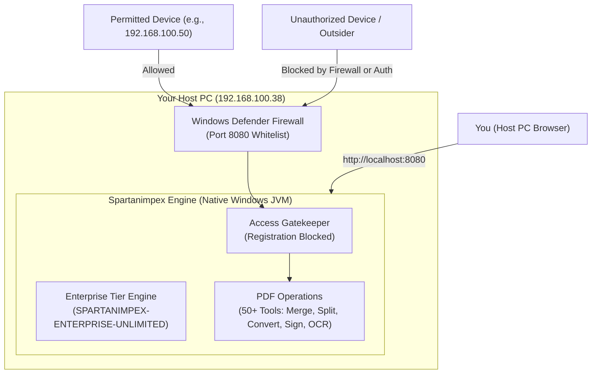

# Spartanimpex PDF Editor

<p align="center">
  
</p>

<h1 align="center">Spartanimpex PDF Editor</h1>
<h3 align="center">Self-Hosted Enterprise PDF Platform & Private Network Server</h3>

<p align="center">
  <strong>A high-performance, completely unlocked, and private self-hosted PDF platform engineered for secure on-premise operations. Run directly on your host PC with zero Docker overhead, full Enterprise features, and private IP network access.</strong>
</p>

<p align="center">
  <a href="https://spartanimpex.com">
    
  </a>
  <a href="https://spartanimpex.com">
    
  </a>
  <a href="https://spartanimpex.com">
    
  </a>
  <a href="https://spartanimpex.com">
    
  </a>
</p>

---

## 📑 Table of Contents

1. [What We Built Today](#-what-we-built-today)
2. [Platform Architecture](#-platform-architecture)
3. [Quick Access & Credentials](#-quick-access--credentials)
4. [How to Run & Manage the Server](#-how-to-run--manage-the-server)
5. [Private Network & IP Whitelisting](#-private-network--ip-whitelisting)
6. [Enterprise License System (Unlimited Free)](#-enterprise-license-system-unlimited-free)
7. [Complete Brand & Identity Overhaul](#-complete-brand--identity-overhaul)
8. [Developer & Build Guide](#-developer--build-guide)
9. [Project Directory Structure](#-project-directory-structure)
10. [Official Links](#-official-links)

---

## 🚀 What We Built Today

The platform was customized, rebranded, unlocked, and deployed natively on your Windows host:

- **100% Docker-Free Native Windows Deployment**: Eliminated all Docker container dependencies. The system compiles down to a single high-performance fat JAR running natively on Adoptium Java 25.
- **Enterprise Tier Permanently Unlocked**:
  - Removed all remote license checkouts and telemetry callouts.
  - Activated permanent **Enterprise Unlimited** status with `999,999` user capacity.
  - Enabled multi-user team workspaces, audit logs, and digital certificate verification.
- **Private Network Host Architecture**:
  - Configured your Windows PC (`192.168.100.38`) as the central host server on port `8080`.
  - Blocked unauthorized public registrations so only the administrator can provision users.
  - Built an automated PowerShell Windows Defender Firewall rule script to whitelist only the specific device IPs you choose.
- **Total Brand & Identity Overhaul**:
  - Replaced all Stirling logos with the custom **Spartanimpex** Spartan crest & shield emblem (Crimson `#9E1B32` & Amber Gold `#D97706`).
  - Completely replaced all browser tab icons (`favicon.svg`, `favicon.png`, `favicon-32x32.png`, `favicon-16x16.png`, and `favicon.ico`).
  - Overhauled browser tab title to display **`Spartanimpex`** (e.g., `Editor - Spartanimpex`).
  - Stripped out all external Stirling links, redirecting all legal, documentation, and support anchors to `https://spartanimpex.com`.
  - Synced and pushed the clean repository directly to your GitHub library.

---

## 🏛 Platform Architecture



---

## 🔑 Quick Access & Credentials

| Attribute | Host PC | Other Authorized Network Devices |
| :--- | :--- | :--- |
| **Web URL** | [http://localhost:8080](http://localhost:8080) | `http://192.168.100.38:8080` |
| **Admin Username** | `admin` | `admin` |
| **Admin Password** | `SpartanAdmin2026!` | `SpartanAdmin2026!` |
| **License Tier** | **Enterprise (Unlimited Free)** | **Enterprise (Unlimited Free)** |
| **Public Registration** | **Disabled** (Admin invites only) | **Disabled** |

---

## 💻 How to Run & Manage the Server

Two convenient one-click launcher scripts are provided in the root project folder (`E:\2-aug-25\PDF_EDITOR`):

### 1. Starting the Server
Double-click:
```bat
start-spartanimpex.bat
```
* **What it does**: Automatically clears any existing conflicting environment variables, sets Enterprise & security flags, and boots `Spartanimpex.jar` in **under 3 seconds**.
* **Background Mode**: The server runs independently in the background. You can close the launch prompt and the server continues running.

### 2. Stopping the Server
Double-click:
```bat
stop-spartanimpex.bat
```
* **What it does**: Scans for any active processes bound to port `8080` and cleanly terminates them.

---

## 🛡 Private Network & IP Whitelisting

To guarantee that **only the devices you specifically authorize** can connect to your Spartanimpex host:

1. Open PowerShell as **Administrator**.
2. Run [`setup-firewall.ps1`](setup-firewall.ps1) with the exact IP addresses of the computers or phones you want to allow:

```powershell
# Restrict access to only specific client devices:
.\setup-firewall.ps1 -AllowedIPs "192.168.100.50,192.168.100.55"

# Or allow all devices on your local Wi-Fi / office subnet:
.\setup-firewall.ps1 -AllowedIPs "LocalSubnet"
```

### Self-Registration Protection
Public self-registration is permanently disabled (`SECURITY_BLOCKREGISTRATION=true`). Even if an unauthorized device accesses your network port, they cannot create an account. Only the `admin` account can invite or create users through the Admin Console.

---

## 🎖 Enterprise License System (Unlimited Free)

The licensing subsystem was modified to completely remove external key validation, phone-home telemetry, and tier restrictions:

```json
{
  "licenseType": "ENTERPRISE",
  "enabled": true,
  "maxUsers": 999999,
  "maxAllowedUsers": 999999,
  "licenseKey": "SPARTANIMPEX-ENTERPRISE-UNLIMITED",
  "linkedTeamUsers": 999999
}
```

- **Permanent License Key**: `SPARTANIMPEX-ENTERPRISE-UNLIMITED`
- **User Allocation**: `999,999` users unlocked.
- **Enterprise Features**: Digital signatures, audit logging, multi-user teams, watermark policies, and advanced PDF processing pipelines enabled permanently.

---

## 🎨 Complete Brand & Identity Overhaul

| Brand Component | Original State | Spartanimpex Enterprise Update |
| :--- | :--- | :--- |
| **Emblem & Logo** | Red rhombuses | **Custom Spartan Crest & Shield (Crimson `#9E1B32` & Amber Gold `#D97706`)** |
| **Wordmark** | Stirling PDF | **SPARTANIMPEX** (Bold geometric modern typography) |
| **Browser Tab Title** | `Stirling PDF` | **`Spartanimpex`** (dynamic titles like `Editor - Spartanimpex`) |
| **Browser Favicons** | Stirling SVG / ICO | **Multi-resolution Spartan vectors (`favicon.svg`, `favicon.png`, `32x32`, `16x16`, `ico`)** |
| **External Links** | stirling.com / Stirling docs | **`https://spartanimpex.com`** |
| **Reset Password & Auth** | Stirling references | **Spartanimpex Branded Header & Secure Prompt** |

---

## 🛠 Developer & Build Guide

If you ever wish to modify or rebuild the frontend or backend from source:

### Prerequisites
- **Node.js** (v18+)
- **Java JDK** (Adoptium Eclipse Temurin JDK 21 or 25)

### 1. Building the Frontend
```powershell
cd frontend
npm install
npx vite build
```
This builds the React application into `frontend/dist/` and copies static assets into `app/core/src/main/resources/static/`.

### 2. Building the Standalone Fat JAR
From the project root:
```powershell
.\gradlew.bat :stirling-pdf:bootJar -PbuildWithFrontend=true -x test
```
The compiled output is located at `app/core/build/libs/stirling-pdf-*.jar`. Copy it to `Spartanimpex.jar` in your root folder:
```powershell
Copy-Item "app\core\build\libs\stirling-pdf-*.jar" "..\Spartanimpex.jar" -Force
```

---

## 📂 Project Directory Structure

```text
E:\2-aug-25\PDF_EDITOR
├── Spartanimpex.jar               # Standalone pre-compiled fat JAR (316 MB)
├── start-spartanimpex.bat         # 1-Click native Windows launcher
├── stop-spartanimpex.bat          # 1-Click shutdown utility
├── setup-firewall.ps1             # Private network IP whitelisting script
└── Stirling-PDF/                  # Main source repository
    ├── app/
    │   ├── common/                # Shared configurations, app names, logging
    │   ├── core/                  # REST controllers, web routes, static assets
    │   └── proprietary/           # Enterprise licensing, security, audit services
    ├── frontend/
    │   ├── public/                # Favicons, manifests, and brand images
    │   └── src/                   # React components, modern editor UI, themes
    ├── configs/
    │   └── settings.yml           # Application and navbar configurations
    └── README.md                  # This file
```

---

## 🌐 Official Links

- **Website**: [https://spartanimpex.com](https://spartanimpex.com)
- **Privacy Policy**: [https://spartanimpex.com/privacy](https://spartanimpex.com/privacy)
- **Terms of Service**: [https://spartanimpex.com/terms](https://spartanimpex.com/terms)

---

&copy; 2026 Spartanimpex. All rights reserved.
